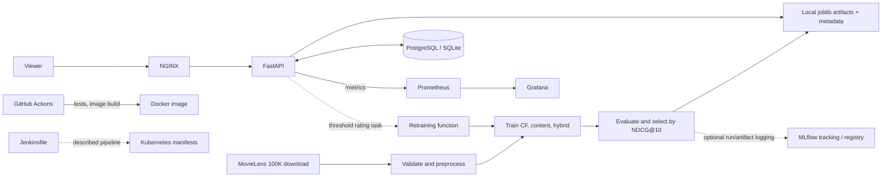

# CineMatch MLOps: project overview

## What it does

CineMatch is a movie recommender prototype: it loads the MovieLens 100K dataset, trains collaborative-filtering, genre-based content-filtering, and hybrid recommenders, evaluates them, saves artifacts, and exposes catalog, recommendation, rating, health, and metrics endpoints through FastAPI. A SQL database stores the catalog, users, ratings, and recommendation logs. Container and Kubernetes manifests describe possible deployment environments. Sources: `src/training/train.py::train_pipeline`, `src/api/main.py`, `src/database/models.py`.

The business problem is to help a viewer find movies they may like based on ratings by similar users and the genres of movies they rated. This is evident from the model implementations and API; the repository does not specify a real business, customer, product objective, or production SLO. Calling it “production-grade” is the README's description, not a demonstrated service guarantee (`README.md`).

## Technology stack

`requirements.txt` declares lower bounds, not exact package versions. Consequently, the project does not establish a reproducible Python dependency lock. Container image tags are exact as written but are not necessarily immutable digests.

| Tool / library | Version in repository | Where used | Why (evidence) | Alternatives / trade-offs |
|---|---|---|---|---|
| Python | README says 3.11+; Docker uses `python:3.11-slim` | All application code | **Confirmed from repo (README/config):** Python is the runtime and Docker base (`README.md`, `Dockerfile`). | Other supported Python versions; 3.11 compatibility is explicit for CI and image, not enforced by packaging metadata. |
| NumPy, pandas | `numpy>=1.24.0`, `pandas>=2.0.0` | Arrays, tables, ratings/data preparation (`src/data/*`, `src/models/*`) | **Confirmed from repo (code/config):** used for numerical and tabular work. | Polars / PyArrow / native SQL; these may scale better for some workloads but require different code. |
| SciPy | `scipy>=1.11.0` | Sparse matrices and truncated SVD (`src/data/preprocess.py`, `src/models/collaborative.py`) | **Confirmed from repo (code):** `csr_matrix` and `svds` implement the factorization path. | A recommender library, ALS, or a distributed factorization; different objective, complexity, and operational burden. |
| scikit-learn | `scikit-learn>=1.3.0` | ID encoding, split helper, cosine similarity (`src/data/preprocess.py`, `src/models/content_based.py`) | **Confirmed from repo (code):** imported utilities perform these tasks. | Explicit lookup maps and custom similarity; lower dependency surface but more implementation work. |
| joblib | `joblib>=1.3.0` | Pickle-like local artifact persistence (`src/models/*.py`, `src/data/preprocess.py`) | **Confirmed from repo (code):** model/preprocessor state is serialized to `.joblib`. | MLflow model format, ONNX, or another serializer; joblib is convenient for Python objects but is Python/library-version sensitive and must be trusted when loaded. |
| FastAPI, Pydantic, Uvicorn | `fastapi>=0.104.0`, `pydantic>=2.5.0`, `uvicorn[standard]>=0.24.0` | HTTP API, request/response validation, ASGI server (`src/api/*`, `run_project.py`) | **Confirmed from repo (code):** the app defines FastAPI routes and Pydantic schemas and is launched by Uvicorn. | Flask / Django REST Framework; FastAPI provides typed schemas and generated OpenAPI docs, while other stacks have different ecosystem and convention trade-offs. |
| SQLAlchemy | `sqlalchemy>=2.0.0` | ORM and DB sessions (`src/database/*`, `src/api/main.py`) | **Confirmed from repo (code):** ORM models and queries are used. | SQL directly or Django ORM; ORM eases mapping but can obscure query behavior and needs migrations for schema evolution (none are present). |
| PostgreSQL / SQLite | Postgres image `15-alpine`; SQLite selected as fallback | Runtime catalog and ratings DB (`docker-compose.yml`, `src/database/db.py`) | **Confirmed from repo (code/config):** PostgreSQL is attempted; SQLite is a local fallback. | One managed DB engine only; SQLite is convenient locally but has different concurrency and operational properties from PostgreSQL. |
| MovieLens 100K | Dataset URL in code; no release pin/checksum recorded | Training input and seed source (`src/data/download.py`, `src/database/init_db.py`) | **Confirmed from repo (code):** source is the GroupLens `ml-100k.zip` URL. | A newer MovieLens version or licensed/internal catalog; dataset selection changes coverage and reproducibility. |
| MLflow | `mlflow>=2.9.0`; Compose image `v2.9.2` | Experiment runs and optional registry (`src/training/mlflow_utils.py`, `src/training/train.py`) | **Confirmed from repo (code):** parameters, metrics, artifacts, and candidate registration are supported by utility functions. | W&B or a cloud registry; a registry is useful for versioning, but this code does not wire registry promotion to serving. |
| Prometheus client / Prometheus | Client `>=0.19.0`; server `v2.48.0` | Instrumentation, scrape target, counters/gauges/histograms (`src/monitoring/metrics.py`, `docker/prometheus/prometheus.yml`) | **Confirmed from repo (config/code):** Prometheus scrapes `/metrics`. | OpenTelemetry plus a metrics backend, Datadog, etc.; Prometheus is self-hostable but needs configured retention/alerting for production operations. |
| Grafana | Image `10.2.0` | Dashboard provisioning (`docker/grafana/*`) | **Confirmed from repo (config):** a dashboard visualizes Prometheus query results. | Another dashboard/observability service; Grafana requires the datasource and dashboard to be reachable and configured. |
| Docker / Compose | Dockerfile; Compose file says `3.8` (obsolete in current Compose) | Container image and local multi-service topology | **Confirmed from repo (config):** Docker packages the API; Compose describes six services. | Native virtualenv or another container runtime/orchestrator. Containerization standardizes runtime but adds image-build and service configuration requirements. |
| NGINX | Compose image `nginx:alpine` | HTTP proxy and rate-limiting config (`docker/nginx/nginx.conf`) | **Confirmed from repo (config):** proxies traffic to the API and applies a request limit. | Ingress controller, managed load balancer, or direct API access; proxy centralizes routing but is another availability/configuration layer. |
| Kubernetes | YAML API versions are declared in manifests | Deployment, service, HPA, ingress, PostgreSQL (`k8s/*.yaml`) | **Confirmed from repo (config):** manifests define replicas, probes, resources, scaling, and routing. | Compose for a single host or managed platform; K8s supports orchestration but these manifests are not a complete release or secrets strategy. |
| GitHub Actions / Jenkins | Actions `checkout@v4`, `setup-python@v5`; Jenkinsfile has no plugin pins | CI tests/build; Jenkins additionally describes deploy stages | **Confirmed from repo (config):** both pipeline definitions exist. | One CI system only; maintaining two definitions risks drift, visible in their different gates and deployment behavior. |
| pytest / HTTPX | pytest `>=7.4.0`, HTTPX `>=0.25.0` | Unit and FastAPI `TestClient` tests (`tests/*`) | **Confirmed from repo (code/config):** tests use pytest and FastAPI's test client. | unittest / another integration runner; pytest fixtures are concise, but the current suite has no external DB/service integration harness. |

**Why labels:** each “why” above is explicitly tagged either as confirmed evidence (imports, code, config, or README assertion) or as inference for alternatives/trade-offs; the repository does not record decision records or commit history beyond its initial commit.

## Architecture

Solid arrows represent code/config paths that can be traced; dotted arrows represent optional or described paths that are incomplete. In particular, the running retraining code does not call a drift detector or promote an MLflow version, and the `Jenkinsfile`'s image push is commented out. References: `src/training/train.py::train_pipeline`, `src/training/retrain.py::run_automated_retraining`, `src/api/main.py::submit_rating`, `docker-compose.yml`, `.github/workflows/ci-cd.yaml`, `Jenkinsfile`.

## Repository map

| Path | Purpose |
|---|---|
| `README.md` | Project claims, advertised architecture, quickstart, tests, retraining, and K8s commands. Treat claims as intended behavior; use code to verify implementation. |
| `requirements.txt`, `.env.example`, `pyrightconfig.json`, `.gitignore` | Dependency lower bounds, example settings, editor type-check configuration, and ignored artifact patterns. |
| `run_project.py` | CLI for setup, train, test, serve, or sequential `all` action. |
| `src/data/` | MovieLens downloader/loaders, cleaning, encoding, splitting, feature extraction, validation. |
| `src/models/` | SVD collaborative, genre-content, hybrid recommenders, ranking/rating evaluation. |
| `src/training/` | Training orchestration, MLflow helpers, retraining/quality-gate function. |
| `src/database/` | SQLAlchemy connection selection, ORM schema, seed/init routine. |
| `src/api/` | FastAPI endpoints and Pydantic request/response structures. |
| `src/monitoring/` | Prometheus metric definitions and standalone rating-distribution drift detector. |
| `tests/` | Model, data, drift, and API tests. |
| `data/movies.db` | Tracked SQLite file; its tables are `movies`, `users`, `ratings`, `recommendation_logs`, and `drift_logs` (verified read-only with SQLite CLI). Row counts/content were not queried. |
| `data/top_posters.json` | Movie-title-keyed poster/plot/rating/director/actor metadata; no checked-in application code reads it. |
| `mlflow.db` | Tracked SQLite database with MLflow-related tables; no claim is made that this is a canonical production tracking store. |
| `docker/` | Compose monitoring, Grafana provisioning/dashboard, NGINX config. |
| `k8s/` | Namespace, config map, API deployment/service, HPA, ingress, and PostgreSQL manifests. |
| `.github/workflows/ci-cd.yaml` | GitHub Actions test and conditional Docker build jobs. |
| `Jenkinsfile` | Additional CI/deploy pipeline definition. |

Not found in the tracked inventory: frontend source/build files, notebooks, Makefile, DVC/feature-store config, Airflow/Prefect/Kubeflow DAGs, Terraform, Helm chart, or migration scripts. The `Dockerfile` and API refer to a `frontend/` directory, but no such directory is present in this checkout.

## History and evidence limits

The complete Git history contains one commit, `9c8aae8` (`first commit`, 2026-10-19). Therefore, there is no earlier implementation trail or commit-based explanation for design choices. Package versions and service images are described in `requirements.txt`, `Dockerfile`, `docker-compose.yml`, and workflow configs; dependency versions actually installed in a working environment are not recorded.
